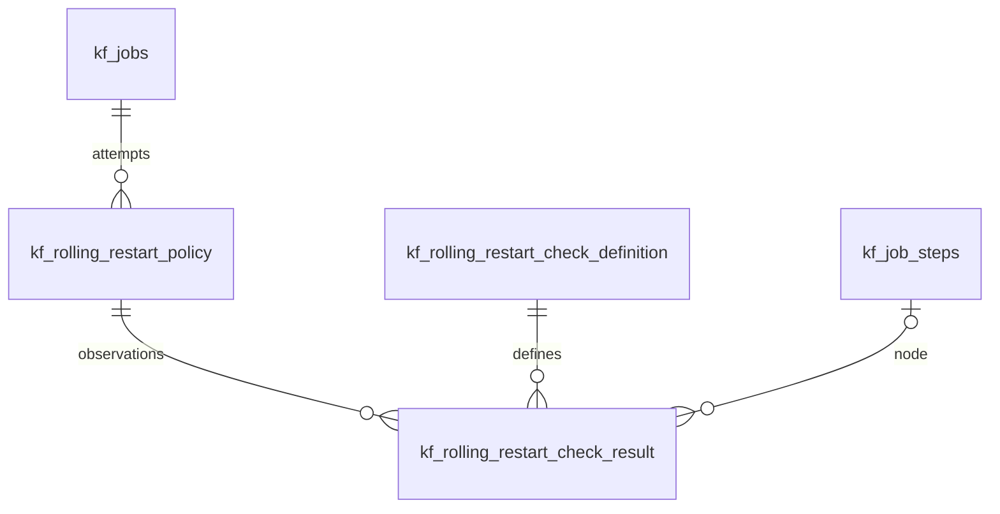

# Rolling Restart policy and health-check persistence

V102 closes the standalone `ROLLING_RESTART` evidence gap. The checks already ran, but their individual results and effective policy were not saved. Existing combined job/task success messages are not equivalent to a complete per-check history. Config Change `kf_health_check` records remain a separate workflow and are not repurposed.

| Draw.io concept | Physical persistence |
|---|---|
| Restart | `kf_jobs` plus `kf_rolling_restart_table` inventory/status summary |
| Role | summary `role_per_node` JSON and each `kf_job_steps.payload` |
| Flow/order/execution | jobs, ordered steps, execution timestamps, internal `kf_tasks` or external `kf_external_kafka_tasks` |
| Safety policy/version | **`kf_rolling_restart_policy`**: immutable settings and algorithm version per job attempt |
| Check definition/version | **`kf_rolling_restart_check_definition`**: versioned check keys, descriptions and rules |
| Individual check result | **`kf_rolling_restart_check_result`**: immutable observation, definition FK, policy FK, optional step FK, phase, sample ID, outcome, metrics, message and observation time |
| Shared operation protection | `kf_cluster_operation_lock`; see [locking contract](cluster-operation-locking.md) |



Policy snapshots are captured when execution begins, before safety gates or mutation dispatch. The snapshot includes effective disk/lag/heartbeat thresholds, health timeout, poll interval, stable sample count, expected brokers, required host IDs, single-host override, and quorum freshness limit. `policy_version=standalone-restart-v1` identifies execution semantics; `definition_version=restart-checks-v1` identifies the check catalogue. A new retry gets a new immutable snapshot (`attempt_number = retry_count + 1`). Re-entering the same attempt reuses its snapshot only when settings match; changed settings require a new retry. Initiating user and cluster are traceable through the job FK. No credentials are copied.

Actual topology checks, preflight polling, baseline/recovery service probes, broker-stop safety, post-restart service probes, quorum observations and stable-sample gates are recorded. Polling retains unsuccessful samples instead of replacing them with the final PASS. Samples share one `sample_id` and observation timestamp. Cluster-wide preflight has `step_id=NULL`; node checks use the actual step ID. Cross-job step links, invalid definitions and non-restart policy owners are rejected. Policy, definitions and result rows reject UPDATE/DELETE. A database write failure stops progression before the next restart dispatch.

PASS means the named check passed. FAIL means its criterion was not met. ERROR means inspection failed. SKIPPED means not applicable (for example a broker-only restart does not inspect controller quorum, or the confirmed single-host override skips broker-stop safety). UNKNOWN means unmeasured, not a successful check. Checks not reached after Kafka inspection failure remain UNKNOWN. Host heartbeat and disk failures from both internal and external discovery agents use the same named check keys. Missing disk metrics retain the existing nonblocking behavior and are explicitly UNKNOWN; this change does not tighten deployment policy.

A stable-samples FAIL during polling means the required consecutive sample count has not yet been reached, not necessarily that the whole operation failed. The eventual job status remains authoritative for the workflow outcome. Policy capture may succeed before a process crash or early failure, so a policy with zero results is not evidence of a successful check. An already-completed step skipped during retry has its original results, not invented new observations.

## Historical coverage

V102 seeds definitions only. It does **not** invent policy snapshots or check outcomes for existing jobs. Their combined logs cannot establish every applied threshold or individual measurement. Historical jobs remain inspectable in jobs/steps/tasks and audit history, with missing structured evidence visible through the LEFT JOIN below. Start a new restart or retry an eligible failed job to collect the new evidence; do not replay successful production restarts solely to populate history.

```sql
-- Coverage, including old jobs without structured evidence.
SELECT j.id, j.status, j.requested_by, p.attempt_number,
       p.policy_version, p.settings, count(r.result_id) AS observations,
       CASE WHEN p.policy_id IS NULL THEN 'NOT_CAPTURED'
            WHEN count(r.result_id)=0 THEN 'POLICY_ONLY'
            ELSE 'OBSERVATIONS_RECORDED' END AS coverage
FROM kf_jobs j
LEFT JOIN kf_rolling_restart_policy p ON p.job_id=j.id
LEFT JOIN kf_rolling_restart_check_result r ON r.policy_id=p.policy_id
WHERE j.type='ROLLING_RESTART'
GROUP BY j.id,p.policy_id
ORDER BY j.created_at,p.attempt_number;

-- Replace :job_id with a restart UUID string in pgAdmin.
SELECT p.job_id,p.attempt_number,p.policy_version,r.phase,s.target_id,
       r.check_key,d.rule,r.outcome,r.observed_at,r.sample_id,r.metrics,r.message
FROM kf_rolling_restart_check_result r
JOIN kf_rolling_restart_policy p USING(policy_id,definition_version)
JOIN kf_rolling_restart_check_definition d USING(definition_version,check_key)
LEFT JOIN kf_job_steps s ON s.id=r.step_id
WHERE p.job_id=:job_id
ORDER BY p.attempt_number,r.observed_at,r.sample_id,r.check_key;
```

The original Draw.io file was not supplied for editing. This mapping and its ER diagram describe the implemented relationships to incorporate into that design. Config-driven restart children (`kf_rolling_restart_operation`, `kf_rolling_restart_node_step`) and their existing Config Change health evidence are outside this standalone policy catalogue.
